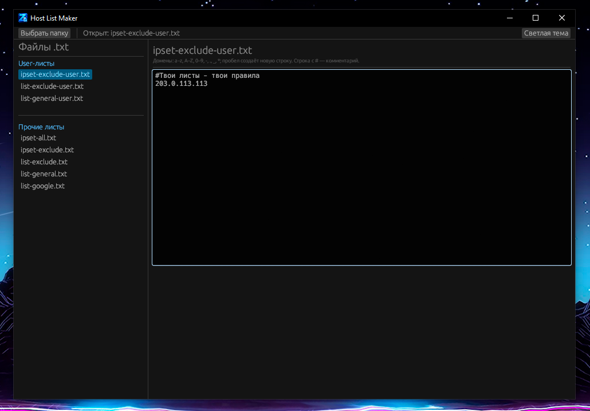

<div align="center">

# ⚡ Host List Maker

**Компактный портативный редактор юзер-листов для [Zapret](https://github.com/Flowseal/zapret-discord-youtube)**

Один `.exe` · без установки · автосохранение · валидация в реальном времени

</div>

---

## 📖 О чём это

Утилита для быстрого редактирования текстовых листов, которые использует Zapret.
Сканирует папку с листами, разделяет их на **user-листы** и **прочие**, открывает файл по клику и
сохраняет изменения на лету — без кнопок «Сохранить» и лишних телодвижений.

Идеально, когда нужно оперативно добавить/убрать домен в `*-user.txt`, не открывая блокнот
и не рискуя сломать формат.

---

## ✨ Возможности

-  **Выбор папки** — одно нажатие, и все `.txt`-листы подхвачены.
-  **Умная сортировка** — файлы с `user` в имени идут в отдельный раздел «User-листы», остальные — в «Прочие».
-  **Мгновенное открытие** — клик по файлу сразу грузит его в редактор.
-  **Автосохранение** — каждое изменение пишется на диск автоматически.
-  **Валидация на лету**:
    - разрешены только символы доменных имён (`a-z`, `A-Z`, `0-9`, `-`, `.`, `_`, `*`);
    - **пробел = перенос строки**;
    - пустые строки и строки из пробелов удаляются сами;
    - недопустимые символы отбрасываются при вводе.
    - строки, начинающиеся с `#`, считаются комментариями: в них можно писать обычный текст с пробелами и любыми символами.
-  **Портативность** — настройки в `config.json` рядом с `.exe`. Ничего в реестр и `AppData`.
-  **Тёмная тема** — глазам приятно.

---


<div align="center">

<!-- Замени на реальный скриншот -->


</div>

---

## 🚀 Быстрый старт

### Готовый бинарник

1. Скачай последний релиз из [Releases](../../releases).
2. Положи `.exe` в любую папку.
3. Запусти — и выбери папку с листами Zapret.

> Никаких зависимостей, установок и прав администратора.

### Сборка из исходников

```bash
# Требуется Rust toolchain (stable)
git clone https://github.com/<your-username>/host-list-maker.git
cd host-list-maker
cargo build --release
